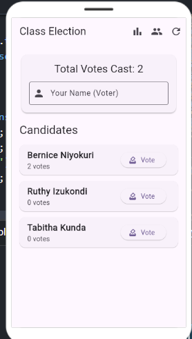
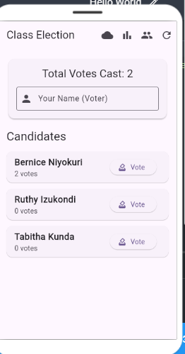
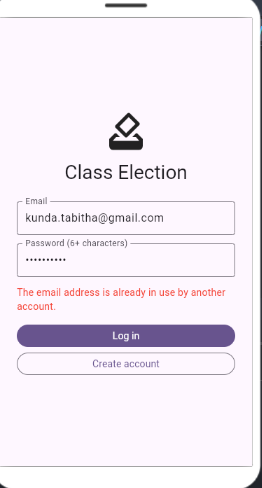
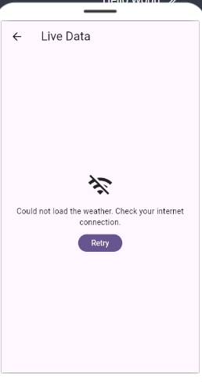

# Class Election

A Flutter mobile app for managing and viewing class election candidates, votes, and results in real-time using Firebase.

## Features

- Login screen with authentication
- View candidates
- Live voting data
- Election results
- Offline/no-internet handling

## Screenshots

| Login | Candidates | Results |
|-------|------------|---------|
|  | .png) |  |

| API | Denied | No Internet |
|-----|--------|-------------|
|  |  |  |

## Getting Started

- [Flutter documentation](https://flutter.dev/docs)
- [FlutLab IDE](https://flutlab.io)
