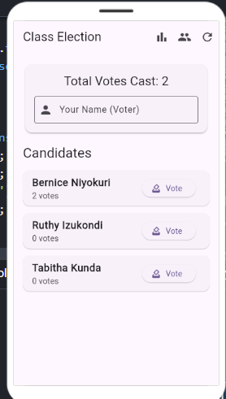
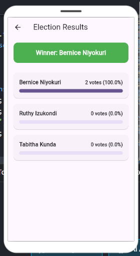
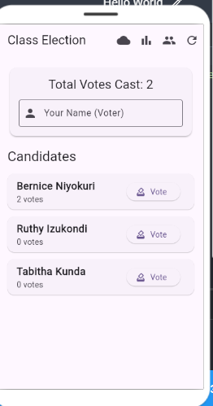

# Class Election

A Flutter app where the class votes for its representative, with ranked results and tie detection.

My data is now saved on the phone with shared_preferences, so nothing is lost when the app closes, and it shows the current temperature in Kigali from the Open-Meteo API.

## Screenshots

## Think

**1. Why must names be cleaned before they are compared?**
Without cleaning, "aline" and "  ALINE " look like two different people, so the same voter could vote twice and the results would be wrong. My cleanName function removes extra spaces and writes the name in Title Case, so both become "Aline" and the second vote is refused.

**2. How does my app decide between a winner and a tie?**
It sorts the candidates from the most votes to the fewest and takes the highest vote count. Then it collects every candidate who has exactly that count. If only one candidate has it, that candidate is the winner. If more than one has it, the banner says there is a tie between them instead of picking one. If nobody has voted yet, it says "No votes yet".